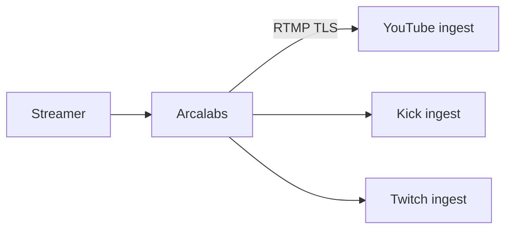
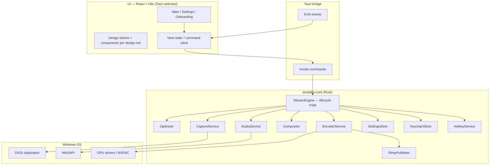
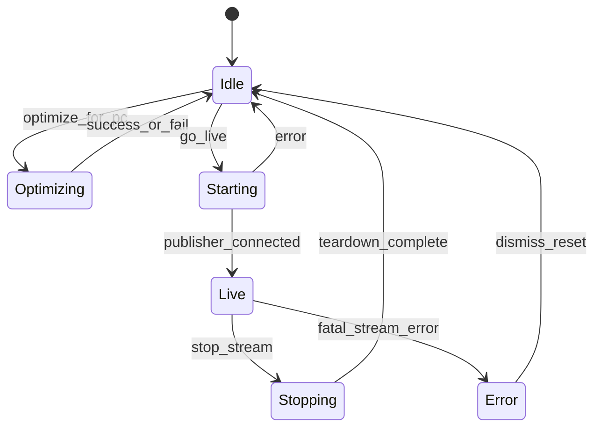

# Arcalabs — System Architecture

| Field | Value |
|-------|--------|
| Status | **Draft — pending review** |
| Date | 2026-11-12 |
| Repo | [cxernlol/ArcaLabs](https://github.com/cxernlol/ArcaLabs) |
| Platform (v1) | **Windows 10/11** (WebView2, DXGI, WASAPI) |
| Related | [`design.md`](../../design.md) (UI), [`AGENTS.md`](../../AGENTS.md) (process & privacy) |

---

## 1. Executive summary

**Arcalabs** is a lightweight desktop streaming application for **YouTube, Kick, and Twitch**. It targets **new and casual streamers** who want to go from launch to **Live in about one minute**, without configuring encoders manually.

The product differentiator is **automatic-first encoding**: the Rust core detects hardware, picks encoder / resolution / frame rate / bitrate for the PC, and the UI presents the result as **old → new with Undo**—not as a form to fill in.

**Technical shape:** [Tauri 2](https://v2.tauri.app/) with a **Rust streaming core** and a **system webview UI** (React + Vite). v1 is **Windows-only**. The UI follows `design.md`; feature work follows **`SPEC.md` per slice** after this document is approved.

**Long-term engineering goal:** a **native Rust pipeline** (capture → composite → encode → RTMP) with disciplined memory use. FFmpeg may appear **temporarily** behind a narrow adapter for RTMP or probe tasks only—not as the permanent heart of the app.

---

## 2. Goals and success criteria

### 2.1 Product goals

| Goal | How we know |
|------|-------------|
| Fast path to live | First-run onboarding + optimize + Go Live achievable in ~1 minute on a typical gaming PC |
| Automatic-first | Default Video mode is Automatic; manual fields are secondary / collapsed |
| Trust via reversibility | Optimize shows struck-through prior values and **Undo**; snapshot persisted locally |
| Obvious live state | Header, primary button, status bar, and Stream panel agree on offline vs live |
| Privacy by default | No telemetry; stream is the only outbound network connection (see §13) |
| Lightweight | Meaningfully lower idle RAM than Electron-based stream clients (target: **&lt;150 MB** idle UI + core with preview off; **&lt;350 MB** while streaming 1080p60 with NVENC—revisit with profiling) |

### 2.2 Engineering goals

- **Clear Rust/UI boundary** — UI never polls heavy state; metrics arrive as events (~1 Hz).
- **Testable core** — `arcalabs-core` runs without webview for unit/integration tests where feasible.
- **Minimal Tauri capabilities** — strict CSP; no HTTP permissions beyond what a future approved spec requires.
- **Spec-driven delivery** — each milestone has an approved `SPEC.md` before implementation code.

### 2.3 Non-goals (v1)

- macOS / Linux ports (design for them in interfaces, do not implement yet).
- Custom RTMP / more than three platforms in the platform selector UI.
- Browser sources, complex filters, replay buffer, multistream, cloud sync, plugins.
- Chat overlays, alerts, tipping integrations.
- Recording-only mode (may come later; out of v1 unless a spec says otherwise).
- OBS scene collection import.

---

## 3. Constraints and invariants

### 3.1 From `AGENTS.md` (non-negotiable)

- No telemetry, analytics, crash reporting, or automatic GitHub reporting.
- Stream keys only in **OS keychain** (Windows Credential Manager via Tauri / `keyring`); never plain config, localStorage, or logs.
- Network: **stream to chosen platform only** unless another call is listed in an approved `SPEC.md` and is off or opt-in.
- Dependencies must not phone home; justify each crate/npm package in the relevant spec.

### 3.2 From `design.md` (UI invariants)

- Dark-only; Inter bundled locally; Lucide only.
- One solid purple primary action per screen; **Go Live** / **Stop stream** occupy the same slot.
- Nested radius rule: `inner = max(0, outer − gap)`.
- Custom selects and menus (no native `<select>`).
- Live metrics: CPU %, fps, kbps, dropped frames, elapsed time; tabular numerals.

### 3.3 Platform (v1)

| Layer | Technology |
|-------|------------|
| Shell | Tauri 2, `decorations: false`, custom title bar + drag region |
| Webview | WebView2 (Edge Chromium) |
| Display capture | DXGI Desktop Duplication API |
| Camera | Media Foundation / `nokhwa` or `windows` capture (final choice in encoder/capture spike) |
| Audio in | WASAPI (microphone + loopback desktop audio) |
| Audio out (monitoring) | WASAPI render (optional v1—may be mute-only meters first) |
| GPU encode | NVENC (primary), AMF / QSV if feasible in v1.x; **x264** software fallback |
| Stream protocol | RTMP (FLV mux) to platform ingest URLs |

---

## 4. System context



Everything outside RTMP to the selected platform stays on-device: optimize probes, settings, logs, keychain.

---

## 5. Architectural overview



### 5.1 Principles

1. **Single owner of truth** — `StreamEngine` holds authoritative runtime state (offline, starting, live, stopping, error).
2. **UI is thin** — No business logic for encode selection in TypeScript; display and invoke only.
3. **Bounded queues** — Capture and encode paths use fixed-size frame/audio buffers; drop policy defined explicitly under overload.
4. **Adapter pattern for encoders** — `EncoderBackend` trait: `Nvenc`, `X264`, later `Amf` / `Qsv`.
5. **Replaceable RTMP** — `MuxSink` trait; v1 implementation may use `ffmpeg` subprocess **only behind** this trait until native mux lands.

---

## 6. Repository and crate layout

```
ArcaLabs/
├── AGENTS.md
├── design.md
├── GEMINI.md
├── CLAUDE.md
├── apps/
│   └── desktop/                 # Tauri app (src-tauri + frontend bundle)
│       ├── src-tauri/           # Commands, event loop, DI wiring
│       └── ui/                  # React app (or src/ if using tauri template layout)
├── crates/
│   ├── arcalabs-core/           # StreamEngine, types, FSM
│   ├── arcalabs-capture/        # DXGI + camera frames
│   ├── arcalabs-audio/          # WASAPI capture + levels
│   ├── arcalabs-compositor/     # Scene graph → RGBA/YUV frame
│   ├── arcalabs-encode/         # Encoder backends
│   ├── arcalabs-optimize/       # Hardware probe + preset selection
│   ├── arcalabs-stream/         # RTMP publisher + stats
│   ├── arcalabs-config/         # Paths, serde settings, undo snapshot
│   └── arcalabs-platform/       # Keychain, hotkeys (Windows)
├── docs/
│   └── superpowers/
│       ├── specs/               # This document; feature specs as needed
│       └── plans/               # Implementation plans (post-approval)
└── SPEC.md                      # Active feature spec (one at a time; or specs/*.md)
```

**Rationale:** Crates map to replaceable subsystems and keep compile/test cycles fast. `apps/desktop` stays a thin shell.

**Frontend stack (v1 decision):** React 18+, Vite, TypeScript, `lucide-react`, CSS variables for tokens from `design.md`. No component library required in v1; headless patterns + custom components match the design system.

**Package manager:** `pnpm` for UI (or `npm` if contributor friction—lock in first scaffold spec).

---

## 7. Domain model

### 7.1 Platform (stream destination)

```rust
enum Platform {
    YouTube,
    Kick,
    Twitch,
}
```

- Per-platform **ingest URL template** and **stream key** (keychain key = `arcalabs/stream-key/{platform}`).
- UI order in segmented control: **YouTube | Kick | Twitch** (`design.md` §7). PDF mockups sometimes show Twitch first—**design.md wins**.

### 7.2 Video settings

```rust
struct VideoSettings {
    automatic: bool,
    encoder: EncoderChoice,      // e.g. NvencH264, X264
    resolution: Resolution,      // width x height
    frame_rate: u32,
    bitrate_kbps: u32,
    keyframe_interval_sec: u32,  // manual / advanced
}

struct OptimizeSnapshot {
    taken_at: SystemTime,
    before: VideoSettings,
    after: VideoSettings,
}
```

- **Undo** restores `before` from last optimize snapshot in config store.
- While **Automatic** is on, manual fields are disabled in UI; backend still stores concrete values.

### 7.3 Scenes and sources (v1 scope)

**Scenes:** named list; one active; hotkey switching (if in v1 spec).

**Sources (v1 minimum):**

| Type | v1 support |
|------|------------|
| Display capture | Yes — primary monitor by default; enumerate as "Screen 1", etc. |
| Webcam | Yes — single device |
| Image / browser / game hook | No |

**Compositor v1:** Stack sources in z-order (screen full-bleed, webcam picture-in-picture optional—if not in MVP, webcam as replace mode only; lock in first capture spec).

### 7.4 Audio (v1)

- **Microphone** — one default communication device; level meter RMS/peak ~30 fps internal, UI ~10–15 Hz is fine.
- **Desktop audio** — WASAPI loopback; level meter.
- Mix: interleave/mux into stream; simple gain knobs optional v1 (spec decides).

### 7.5 Application state (FSM)



- While **Live**: platform selector disabled; optimize disabled; manual video fields disabled (`design.md` §8).
- **Starting** shows busy state on Go Live (spinner per `design.md` §12).

---

## 8. Optimizer

### 8.1 Purpose

Select `VideoSettings` that balance quality and stability for this PC **without user encoder knowledge**.

### 8.2 Inputs (local only)

- GPU vendor/model (NVENC capable?), driver hints.
- CPU core count / approximate load sample (quick benchmark optional).
- Monitor native resolution and refresh rate.
- Available encoder backends from probe.

**Never transmitted off-device.**

### 8.3 Algorithm (v1 heuristic)

1. Detect **hardware encoder** preference order: NVENC → AMF → QSV → x264.
2. **Resolution:** target 1920×1080 if GPU encoder and display ≥1080p; else 1280×720.
3. **Frame rate:** min(60, display refresh rounded to common value {30, 60}).
4. **Bitrate:** table by resolution/fps (e.g. 1080p60 → 6000 kbps, 720p30 → 4500 kbps)—tunable constants in `arcalabs-optimize`.
5. Compare with **current** settings; build `OptimizeSnapshot` for UI diff + Undo.

### 8.4 Outputs

- Updated `VideoSettings` in config.
- Event / command response with `{ before, after, summary_line }` where `summary_line` matches `NVENC · 1080p60 · 6,000 kbps` pattern.

### 8.5 Failure

- If no GPU encoder: fall back x264 with conservative 720p30 and explain in optimize result (plain language, not jargon-first).

---

## 9. Capture and preview

### 9.1 Display capture (DXGI)

- Duplicate output for selected monitor; handle `ACCESS_LOST` (resolution change, lock screen) by recreating duplication.
- Output pixel format: prefer **BGRA** for compositor; convert once before encode.
- **Preview path:** downscale + throttle (e.g. 30 fps max) to webview via **shared frame strategy**:
  - **v1 recommendation:** Base64/JPEG over events is too heavy; use **`tauri` image/channel** or texture path, or render preview only in Rust native layer later.
  - **MVP spike decision:** For first UI milestone, **placeholder preview** (labeled resolution text per mockup) until shared-texture or efficient IPC is proven; second milestone wires real frames.

> **Open item O1:** Choose preview IPC (JPEG pipe vs `wgpu` readback vs future child window). Document in first capture `SPEC.md`.

### 9.2 Webcam

- Enumerate devices; select by stable ID stored in settings.
- Frame format aligned with compositor.

### 9.3 Performance

- Capture thread(s) separate from encode thread.
- Ring buffer depth: **2–3 frames** for preview; encode queue **2** frames default (low latency bias).

---

## 10. Compositor

- Inputs: ordered list of `Source` with transforms (v1: position + scale for PiP if enabled).
- Output: single `VideoFrame` at **encode resolution** (scaled from scene canvas).
- Runs on CPU for v1 unless GPU compositor spec approved—YAGNI.

---

## 11. Encoder service

### 11.1 Trait

```rust
trait EncoderBackend {
    fn configure(&mut self, settings: &VideoSettings) -> Result<()>;
    fn encode_frame(&mut self, frame: &VideoFrame, ts: StreamTimestamp) -> Result<Vec<EncodedPacket>>;
    fn encode_audio(&mut self, samples: &AudioBuffer, ts: StreamTimestamp) -> Result<Vec<EncodedPacket>>;
    fn flush(&mut self) -> Result<Vec<EncodedPacket>>;
}
```

### 11.2 NVENC (primary)

- Use maintained Rust bindings (e.g. `nvenc` ecosystem crate—exact crate chosen in spike with license check).
- H.264 Baseline/Main per platform compatibility.
- Rate control: CBR matching `bitrate_kbps`.

### 11.3 x264 fallback

- Software encode only when hw unavailable or user forces Manual + x264.
- Thread count capped (e.g. half of logical cores) to avoid starving game.

### 11.4 Audio encode

- AAC-LC via **fdk-aac** / FFmpeg libavcodec adapter / platform-supported encoder—pick in stream spec; must match RTMP FLV expectations.

---

## 12. RTMP publisher

### 12.1 Responsibilities

- Connect TLS to platform ingest URL + stream key (key from keychain at connect time only).
- Mux H.264 + AAC into FLV tags; send on connection.
- Emit **stats**: actual bitrate, dropped frames, connection errors.

### 12.2 Implementation phases

| Phase | Approach |
|-------|----------|
| **Spike** | Validate ingest URLs for three platforms with known-good FFmpeg one-liner (developer machine only). |
| **v1 ship path** | Prefer **native Rust RTMP** (`rtmp`/`rml_rtmp` or similar) if stable; else **`MuxSink::FfmpegPipe`** behind trait with explicit removal issue. |

### 12.3 Reconnect policy (v1)

- **No auto-reconnect** unless spec'd—show error, return to Idle, user taps Go Live again.

---

## 13. Privacy, security, network

| Topic | Behavior |
|-------|----------|
| Telemetry | None |
| Update checks | Out of scope v1; if added later, opt-in per `SPEC.md` |
| CSP | Strict; no external scripts/fonts |
| Capabilities | `core:default` subset; deny broad `http`, `shell` unless required |
| Logs | Local file under `%APPDATA%/Arcalabs/logs`; scrub keys and user paths |
| Stream key in memory | Zeroize after use where possible; never log |

---

## 14. Persistence

| Data | Store |
|------|-------|
| Scenes, sources, video settings, onboarding complete flag, last platform | JSON/TOML in `%APPDATA%/Arcalabs/config.toml` |
| Optimize undo snapshot | Same file or `snapshot.json` |
| Stream keys | Windows Credential Manager |
| Window geometry | Optional `config.toml` section |

---

## 15. Tauri IPC contract

### 15.1 Commands (invoke)

| Command | Description |
|---------|-------------|
| `get_app_state` | FSM state + summary for header/status |
| `get_scenes` / `set_active_scene` | Scene list |
| `get_sources` / `add_source` / `toggle_source_visibility` | Sources panel |
| `get_audio_devices` / `get_audio_levels` | Audio panel (levels also via events) |
| `get_stream_settings` | Platform, masked key hint, spec line |
| `set_platform` | Disabled while live |
| `set_stream_key` | Writes keychain; UI sees masked |
| `optimize_for_pc` | Runs optimizer; returns diff |
| `undo_optimize` | Restores snapshot |
| `get_video_settings` / `set_video_settings` | Settings page |
| `go_live` | Start pipeline |
| `stop_stream` | Teardown |
| `run_first_run_setup` | Persist onboarding completion |
| `register_hotkeys` / `set_hotkey_binding` | Hotkeys settings |

Types exchanged as **serde JSON**; stable field names matter for UI tests.

### 15.2 Events (emit to UI)

| Event | Payload (approx.) | Rate |
|-------|-------------------|------|
| `stream:stats` | `{ cpu_percent, fps, kbps, dropped, elapsed_ms }` | ~1 Hz |
| `stream:state` | `{ state, platform?, live_since? }` | on change |
| `audio:levels` | `{ mic: 0..1, desktop: 0..1 }` | ~10 Hz |
| `preview:frame` | TBD per O1 | ≤30 Hz |
| `optimize:progress` | optional stages for long optimize | sparse |

UI **must not poll** `get_app_state` in a tight loop; use events + initial fetch on mount.

---

## 16. Frontend architecture

### 16.1 Routes / views

- **Main** — preview, four panels, status bar.
- **Settings** — shell with left nav: Stream, Video, Audio, Hotkeys, Advanced.
- **Onboarding** — modal or dedicated route first launch only.

### 16.2 State management

- Lightweight: React context + hooks, or **Zustand** if complexity grows—choose in scaffold spec; avoid Redux unless needed.

### 16.3 Testing

- Vitest + Testing Library for components (tokens, disabled live states, optimize result card).
- Storybook optional—not required v1.

---

## 17. Hotkeys (Windows)

- Registered globally from Rust (`arcalabs-platform`) using `global-hotkey` or Windows RegisterHotKey.
- Bindings stored in config; conflict detection returns user-visible warning in settings UI.
- Default bindings defined in first hotkeys spec (e.g. Go Live toggle).

---

## 18. Delivery phases

Each phase needs an approved **`SPEC.md`** before implementation. Order is fixed unless a spec explicitly revises it.

| Phase | Name | Deliverable |
|-------|------|-------------|
| **P0** | Scaffold | Tauri 2 + React, custom title bar, tokens, empty main window matching layout dimensions |
| **P1** | Settings shell | Nav + Video/Stream pages; Automatic/Manual UI; stub commands |
| **P2** | Optimizer | Real `optimize_for_pc`, snapshot, Undo, spec line |
| **P3** | Onboarding | Three-step flow; keychain write; finish flag |
| **P4** | Capture + preview | DXGI + (optional) camera; meters stub → real |
| **P5** | Audio | WASAPI mic + desktop levels |
| **P6** | Go Live | Encode + RTMP; live stats; stop stream |

**First implementation plan** after this doc is approved should cover **P0 only** (per writing-plans skill).

---

## 19. Testing strategy

| Layer | Tests |
|-------|-------|
| `arcalabs-optimize` | Unit tests with mocked hardware profiles → expected settings |
| `arcalabs-config` | Round-trip serialize; undo snapshot |
| `arcalabs-core` FSM | Illegal transitions rejected; live locks platform |
| Integration | Mock `MuxSink` records packets; no network in CI |
| UI | Component tests for offline/live/optimize card |
| Manual QA | Go live to Twitch sandbox key on Windows; 30 min soak |

CI on GitHub Actions: `cargo test`, `pnpm test`, `cargo clippy` (Windows runner for DXGI tests tagged `windows`).

---

## 20. Dependencies policy

- Every new **crate** and **npm** package appears in the phase's `SPEC.md` with purpose and license.
- GPL-3.0 repo license: avoid linking GPL-incompatible encoder SDKs without legal review; prefer MIT/Apache bindings.
- No crates with built-in analytics (check `default-features = false`).

---

## 21. Risks and mitigations

| Risk | Mitigation |
|------|------------|
| RTMP + AAC complexity | Trait-isolated sink; time-boxed FFmpeg adapter |
| Preview IPC bandwidth | Placeholder UI first; measure before shipping JPEG |
| DXGI loss on display change | Recreate duplication; brief UI message |
| NVENC driver variance | Optimizer fallback to 720p / x264 |
| Scope creep toward OBS parity | `AGENTS.md` + Out of Scope in each `SPEC.md` |

---

## 22. Open decisions (resolve before or during P0–P2 specs)

| ID | Decision |
|----|----------|
| **O1** | Preview frame transport to webview |
| **O2** | Exact NVENC / AAC crates |
| **O3** | Webcam crate (`nokhwa` vs Media Foundation direct) |
| **O4** | PiP vs fullscreen-only webcam in v1 |
| **O5** | Product string: **Arcalabs** vs **Arca Labs** in installer title |

---

## 23. Glossary

- **Automatic / Manual** — UI modes for video settings (`design.md` §8).
- **Optimize** — Local heuristic hardware → `VideoSettings` update.
- **StreamEngine** — Central Rust coordinator.
- **SPEC.md** — Approved feature document before coding (per `AGENTS.md`).

---

## 24. Approval

When this document is approved:

1. File issues or milestones aligned with phases **P0–P6**.
2. Draft **`SPEC.md` for P0 (Scaffold)** and seek approval.
3. Invoke **writing-plans** to produce `docs/superpowers/plans/2026-11-12-p0-scaffold.md`.
4. Implement only after that plan's tasks are agreed.

**Reviewer checklist**

- [ ] Windows-only v1 is acceptable
- [ ] Native pipeline + optional FFmpeg adapter is acceptable
- [ ] Phase ordering matches product priorities
- [ ] IPC command/event list covers mockups
- [ ] RAM targets are reasonable or adjusted
- [ ] Open items O1–O5 have owners or target phases

---

*End of system architecture draft.*
